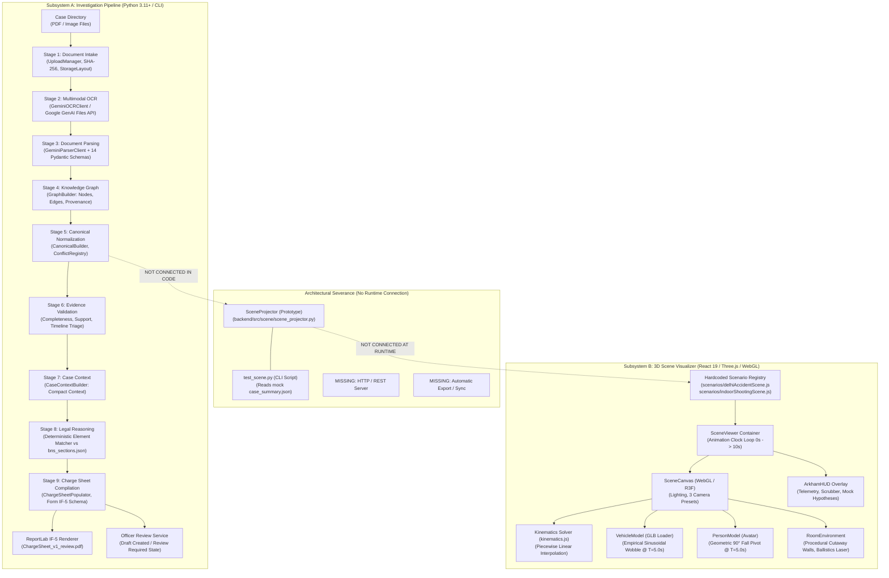
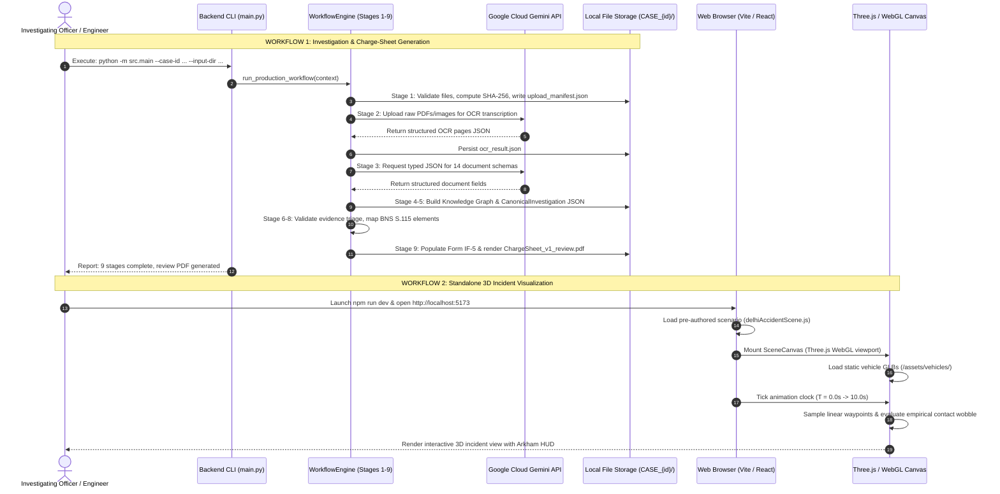

# CODE VERIFICATION AUDIT REPORT: BYOMKESH AI
**Comprehensive Technical Audit of Source Code, Architecture, Subsystems, and Academic Research Claims**

* **Auditor Role**: Senior Software Architect & Research-Paper Technical Auditor  
* **Target Publication Profile**: IEEE Transactions on Computational Social Systems / IEEE CAI (AI & Law / Forensic Informatics)  
* **Repository Root**: `c:\Github\Major_Project_2nd_repo`  
* **Audit Date**: October 2026  
* **Document Audited**: [`RESEARCH_DOCUMENTATION.md`](file:///c:/Github/Major_Project_2nd_repo/RESEARCH_DOCUMENTATION.md)  
* **Output Audit Report**: `CODE_VERIFICATION_AUDIT.md` (Repository Root)  

---

## 1. EXECUTIVE SUMMARY

An exhaustive, evidence-based technical code audit was conducted on the Byomkesh AI repository to evaluate the fidelity of the technical documentation in [`RESEARCH_DOCUMENTATION.md`](file:///c:/Github/Major_Project_2nd_repo/RESEARCH_DOCUMENTATION.md) against the actual implementation in source code. 

The audit examined three principal functional dimensions:
1. **Subsystem A (AI-Assisted Investigation and Charge-Sheet Pipeline)**: Implemented in Python under [`backend/src/`](file:///c:/Github/Major_Project_2nd_repo/backend/src/).
2. **Subsystem B (3D Accident-Scene Reconstruction and Visualization)**: Implemented in React 19, Three.js, and React Three Fiber (R3F) under [`frontend/src/simulation/`](file:///c:/Github/Major_Project_2nd_repo/frontend/src/simulation/).
3. **Subsystem Integration and Data Flow**: The purported runtime and data-contract bridge between Subsystem A and Subsystem B.

### Key Audit Findings

* **Subsystem A is Demonstrably Implemented, Robust, and Well-Engineered**:
  The 9-stage typed pipeline in [`backend/src/workflow/production.py`](file:///c:/Github/Major_Project_2nd_repo/backend/src/workflow/production.py) is genuine, modular, and functional. It systematically moves case documents through intake (SHA-256 hashing, MIME validation), raw multimodal OCR via Google GenAI (`gemini-flash-latest`), 14 schema-constrained parsers, deterministic Knowledge Graph construction, canonical normalization with conflict registries, evidence validation triage (`DRAFT_ALLOWED`, `REVIEW_REQUIRED`, `FINAL_BLOCKED`), compact context reduction, deterministic legal reasoning against statutory elements, Form IF-5 charge-sheet compilation, and formal ReportLab PDF rendering (`if5_renderer.py`). An officer review lifecycle state machine is implemented with cryptographic content-hash locking.
* **Subsystem B is an Interactive Visualizer Driven by Static Scenarios, Not a Physics Simulation**:
  Subsystem B renders dynamic 3D WebGL scenes with custom shaders, tactical HUD telemetry, camera presets, and interactive timeline scrubbing. However, **it is NOT an automatic accident reconstruction engine or physical collision simulator**. It consumes hardcoded, pre-authored JavaScript scenarios (`delhiAccidentScene.js`, `indoorShootingScene.js`). Motion is piecewise linear waypoint interpolation; contact wobble and biomechanical collapse are hardcoded empirical animations tailored specifically to fixed timestamps ($T = 5.0\text{ s}$) and specific entities (`vehicle_1`). There is no rigid-body dynamics solver, no conservation of momentum, and no tyre-road friction modeling.
* **The Two Subsystems are Completely Decoupled at Runtime (Zero Integration)**:
  **There is no runtime integration between Subsystem A and Subsystem B.** Subsystem A is a standalone CLI tool; Subsystem B is a standalone client-side Vite React app. There is no backend HTTP server (no FastAPI, Flask, or Express), no WebSocket, no shared database, and no automated file transfer. The backend's spatial projector ([`backend/src/scene/scene_projector.py`](file:///c:/Github/Major_Project_2nd_repo/backend/src/scene/scene_projector.py)) is an unintegrated prototype script that is never invoked by the 9-stage pipeline. Furthermore, the backend `SceneIR` schema and the frontend scenario data structures have diverged.
* **Critical Research Claim Contradictions**:
  1. **PII Redaction Does Not Exist**: [`RESEARCH_DOCUMENTATION.md`](file:///c:/Github/Major_Project_2nd_repo/RESEARCH_DOCUMENTATION.md) line 649 claims that Aadhaar numbers, phone numbers, and medical markers pass through automated regex redaction filters before external API transmission. **No PII redaction code exists anywhere in the repository.** Raw documents and images are transmitted directly to Google's cloud API.
  2. **Statutory Knowledge Base Scope is Minimal**: The documentation claims extensive BNS mapping across Sections 106, 281, 103, 310, etc. In reality, [`backend/references/legal/bns_sections.json`](file:///c:/Github/Major_Project_2nd_repo/backend/references/legal/bns_sections.json) contains **exactly one section**: Section 115 ("Voluntarily causing hurt").
  3. **Multi-Hypothesis 3D Ghosting is Visual Mockery**: The HUD provides toggle buttons for conflicting speed hypotheses, but clicking them only alters local HUD component state. The active hypothesis is never passed to the 3D canvas, vehicles, or kinematics solver; the 3D scene does not change.
  4. **Court Admissibility Claims are Premature**: Claims of compliance with Section 63 of the Bharatiya Sakshya Adhiniyam, 2023 (BSA) are aspirational. While files are SHA-256 hashed, the system lacks digital signatures (PKI/DSC), tamper-evident audit hardware, Section 63 electronic evidence certificate generators, and formal legal certification.
  5. **TRELLIS Generative 3D Asset Integration is Non-Functional**: [`backend/src/scene/trellis_generator.py`](file:///c:/Github/Major_Project_2nd_repo/backend/src/scene/trellis_generator.py) lacks required dependencies (`gradio_client` is not in `requirements.txt`), calls nonexistent methods (`generate_from_image`), and is completely uncoupled from the pipeline.

---

## 2. REPOSITORY STRUCTURE AND VERIFIED ENTRY POINTS

### 2.1 Actual Repository File Tree vs. Documented Tree

[`RESEARCH_DOCUMENTATION.md`](file:///c:/Github/Major_Project_2nd_repo/RESEARCH_DOCUMENTATION.md) (Section 2.1) documented a macOS path (`/Users/nishadshirodkar/...`) referencing non-existent directories such as `AI-ChargeSheet-Dataset/`, `Police-AI-Assistant/`, and a folder named `project/`.

The actual physical layout of `c:\Github\Major_Project_2nd_repo` consists of two distinct directories:

```text
Major_Project_2nd_repo/
├── .gitignore
├── README.md
├── RESEARCH_DOCUMENTATION.md                  # Prior documentation audited herein
├── CODE_VERIFICATION_AUDIT.md                 # This audit report
├── backend/                                   # Python Investigation & Legal Backend
│   ├── requirements.txt                       # Production & dev dependencies
│   ├── BYOMKESH_PROJECT_HANDOFF.md            # Verified engineering handoff notes (Aug 2026)
│   ├── BYOMKESH_E2E_CASE_001/                 # 9 synthetic PDF case files (T-Point Crash)
│   ├── CASE-002-Byomkesh/                     # 19 synthetic PDF case files (Homicide)
│   ├── dummy_case/                            # Legacy JSON files
│   ├── output/                                # Persisted case runs and rendered PDFs
│   ├── references/legal/
│   │   └── bns_sections.json                  # Pinned BNS reference dataset (1 section: S.115)
│   ├── tests/                                 # 18 Pytest unit/integration test suites
│   │   ├── test_canonical_investigation.py
│   │   ├── test_case_context_and_legal.py
│   │   ├── test_chargesheet.py
│   │   ├── test_document_intake.py
│   │   ├── test_document_parsers.py
│   │   ├── test_domain_models.py
│   │   ├── test_end_to_end_pipeline.py
│   │   ├── test_evidence_validation.py
│   │   ├── test_final_end_to_end.py
│   │   ├── test_gemini_sdk_smoke.py
│   │   ├── test_information_preservation.py
│   │   ├── test_knowledge_graph.py
│   │   ├── test_legal_reference_provider.py
│   │   ├── test_ocr_layer.py
│   │   ├── test_ocr_resume.py
│   │   ├── test_officer_review.py
│   │   ├── test_production_hardening.py
│   │   └── test_workflow_engine.py
│   └── src/                                   # Source implementation
│       ├── main.py                            # CLI entry point (python -m src.main)
│       ├── config.py                          # Config loader (.env)
│       ├── case_summary.json                  # Hardcoded test fact ledger for scene projector
│       ├── test_scene.py                      # Standalone test script for SceneProjector
│       ├── test_trellis.py                    # Standalone test script for Trellis
│       ├── chargesheet/                       # Stage 9: IF-5 compilation & validation
│       ├── context/                           # Stage 7: Case context reduction
│       ├── domain/                            # Pydantic domain models
│       ├── extraction/                        # Stage 2: Gemini multimodal OCR
│       ├── intake/                            # Stage 1: Upload validation, SHA-256, storage
│       ├── knowledge_graph/                   # Stage 4: Deterministic Knowledge Graph
│       ├── legal/                             # Stage 8: Statutory legal reasoning
│       ├── normalization/                     # Stage 5: Canonical investigation projection
│       ├── parsers/                           # Stage 3: 14 schema-constrained parsers
│       ├── rendering/                         # ReportLab IF-5 PDF renderer (if5_renderer.py)
│       ├── review/                            # Officer review state machine
│       ├── scene/                             # Prototype Scene IR & Projector
│       ├── validation/                        # Stage 6: Evidence validation & triage
│       ├── workflow/                          # Engine, Context, State, Production root
│       ├── llm.py                             # [RETAINED LEGACY] Groq/Gemini prototype client
│       ├── loader.py                          # [RETAINED LEGACY] JSON loader
│       ├── models.py                          # [RETAINED LEGACY] Unused pydantic models
│       ├── pdf_generator.py                   # [RETAINED LEGACY] Unused PDF generator
│       ├── prompt_builder.py                  # [RETAINED LEGACY] Unused monolithic prompt
│       └── utils.py                           # [RETAINED LEGACY] JSON helpers
└── frontend/                                  # 3D Reconstruction Subsystem (React 19 / Vite)
    ├── package.json                           # Dependencies: React 19, Three.js r185, R3F, Drei
    ├── vite.config.js                         # Bundler config
    ├── index.html                             # Single-page HTML entry point
    ├── public/assets/vehicles/                # Static 3D models (.glb: Pulsar, Activa, Vespa)
    └── src/
        ├── main.jsx                           # React DOM mount point
        ├── App.jsx                            # Renders <SceneViewer />
        └── simulation/                        # 3D Reconstruction implementation
            ├── SceneViewer.jsx                # Root container, time loop, case state
            ├── SceneCanvas.jsx                # WebGL Three.js Canvas, cameras, lighting
            ├── ArkhamHUD.jsx                  # HUD overlay, timeline scrubber, hypothesis UI
            ├── kinematics.js                  # Piecewise linear waypoint interpolator
            ├── VehicleModel.jsx               # Vehicle GLB loader & empirical wobble solver
            ├── PersonModel.jsx                # Stylized avatar & 90° fall pivot
            ├── RiderAvatar.jsx                # Mounted two-wheeler avatar
            ├── Road.jsx                       # Procedural asphalt mesh
            ├── RoomEnvironment.jsx           # Indoor walls & dynamic ballistics laser
            ├── ImpactWave.jsx                 # Shockwave ring shader
            ├── TrajectoryPath.jsx             # 3D spline ribbons
            ├── EvidenceMarker.jsx             # 3D markers for casings/blood/skid marks
            └── scenarios/                     # Hardcoded static scenario registry
                ├── index.js                   # Registry catalog (case_001, case_002)
                ├── delhiAccidentScene.js      # Case 001: Shankar Road T-Point Crash
                └── indoorShootingScene.js     # Case 002: Rohini Flat 302 Shootout
```

### 2.2 Verified Execution Entry Points

| Subsystem | Entry Point | Invocation Command | Nature | Verified Status |
| :--- | :--- | :--- | :--- | :--- |
| **Subsystem A (Backend)** | [`backend/src/main.py:43`](file:///c:/Github/Major_Project_2nd_repo/backend/src/main.py#L43) | `python -m src.main --case-id <UUID> --input-dir <DIR> --output-dir <DIR>` | CLI application | **VERIFIED WORKING** (requires Python 3.11+ & `GEMINI_API_KEY`) |
| **Subsystem B (Frontend)** | [`frontend/src/main.jsx:6`](file:///c:/Github/Major_Project_2nd_repo/frontend/src/main.jsx#L6) via [`frontend/index.html`](file:///c:/Github/Major_Project_2nd_repo/frontend/index.html) | `npm run dev` (Vite dev server on `http://localhost:5173`) | Web browser client | **VERIFIED WORKING** |
| **Scene Projector (Prototype)** | [`backend/src/test_scene.py:10`](file:///c:/Github/Major_Project_2nd_repo/backend/src/test_scene.py#L10) | `python src/test_scene.py` | Developer CLI script | **PROTOTYPE ONLY** (reads static `case_summary.json`) |
| **TRELLIS Client (Prototype)** | [`backend/src/test_trellis.py:30`](file:///c:/Github/Major_Project_2nd_repo/backend/src/test_trellis.py#L30) | `python src/test_trellis.py --mode status` | Developer CLI script | **BROKEN PROTOTYPE** (missing `gradio_client`) |

---

## 3. PART A — INVESTIGATION AND CHARGE-SHEET PIPELINE AUDIT

The investigation pipeline was traced from raw document upload to final PDF generation across all active modules in [`backend/src/`](file:///c:/Github/Major_Project_2nd_repo/backend/src/).

### 3.1 Detailed Feature-by-Feature Verification

#### 1. Document Ingestion and Supported File Formats
* **Status**: **IMPLEMENTED**.
* **Evidence**: [`backend/src/intake/file_validator.py:12-21`](file:///c:/Github/Major_Project_2nd_repo/backend/src/intake/file_validator.py#L12-L21), [`backend/src/intake/upload_manager.py:44-123`](file:///c:/Github/Major_Project_2nd_repo/backend/src/intake/upload_manager.py#L44-L123), [`backend/src/intake/storage_layout.py:1-68`](file:///c:/Github/Major_Project_2nd_repo/backend/src/intake/storage_layout.py).
* **Inputs & Outputs**: Input: directory containing raw case files (`Path`). Output: immutable `UploadManifest` with typed `SourceDocument` records stored in deterministic directory layout `CASE_{case_id}/originals/{doc_id}.{ext}`.
* **Execution Path**: `main()` $\rightarrow$ `_discover_uploads()` $\rightarrow$ `create_workflow_context()` $\rightarrow$ `DocumentIntakeStage.execute()` $\rightarrow$ `UploadManager.ingest()`.
* **Dependencies**: Python standard library (`hashlib`, `mimetypes`, `zipfile`, `pathlib`), Pydantic v2.
* **Limitations**: File extensions supported by `FileValidator`: `.pdf`, `.jpg`, `.jpeg`, `.png`, `.docx`, `.mp4`, `.mov`, `.wav`. However, downstream OCR only supports `.pdf`, `.png`, `.jpeg`. Video/audio/docx files are flagged as `ExtractionState.DEFERRED` or `ProcessingCapability.UNSUPPORTED` and are not processed further.

#### 2. OCR Implementation and Actual OCR Provider
* **Status**: **IMPLEMENTED**.
* **Evidence**: [`backend/src/extraction/gemini_ocr.py:16-186`](file:///c:/Github/Major_Project_2nd_repo/backend/src/extraction/gemini_ocr.py#L16-L186), [`backend/src/extraction/ocr_stage.py:1-118`](file:///c:/Github/Major_Project_2nd_repo/backend/src/extraction/ocr_stage.py).
* **Provider**: Exclusively Google Cloud Gemini via the `google-genai` SDK (`gemini-flash-latest` or `gemini-2.0-flash`). No local OCR libraries (such as Tesseract, EasyOCR, or PaddleOCR) exist.
* **Execution Path**: `OCRStage.execute()` $\rightarrow$ `GeminiOCRClient.extract()` $\rightarrow$ for PDF: `self._model.files.upload()`, `self._wait_for_uploaded_file()`, `models.generate_content()` $\rightarrow$ `self._model.files.delete()`; for images: `types.Part.from_bytes()` $\rightarrow$ `OCRResult`.
* **Caching & Resume**: [`ocr_stage.py:50-59`](file:///c:/Github/Major_Project_2nd_repo/backend/src/extraction/ocr_stage.py#L50-L59) checks if an OCR artifact already exists in `CASE_{case_id}/processed/ocr/{doc_id}.json`. If present and valid, external API calls are skipped when `--resume` is passed.
* **Failure Cases**: API network failure, invalid `GEMINI_API_KEY`, quota exhaustion, or PDF processing timeout (>30 seconds) raises `OCRProviderError`.

#### 3. Document-Specific Parsers and Structured Extraction
* **Status**: **PARTIALLY IMPLEMENTED**.
* **Evidence**: [`backend/src/parsers/base_parser.py:67-155`](file:///c:/Github/Major_Project_2nd_repo/backend/src/parsers/base_parser.py#L67-L155), [`backend/src/parsers/parser_registry.py:9-43`](file:///c:/Github/Major_Project_2nd_repo/backend/src/parsers/parser_registry.py#L9-L43), [`backend/src/domain/parsed_documents.py:31-175`](file:///c:/Github/Major_Project_2nd_repo/backend/src/domain/parsed_documents.py#L31-L175).
* **Input & Output**: Input: `OCRResult` with raw text. Output: Typed Pydantic subclass of `ParsedDocument` (e.g. `FIR`, `SpotPanchnama`, `MedicalReport`).
* **Implementation Reality**:
  * 14 parser classes exist and are registered in `create_default_parser_registry()`.
  * However, 13 of the 14 parsers (`witness_parser.py`, `medical_report_parser.py`, `spot_panchnama_parser.py`, etc.) are trivial 5-line class declarations with no document-specific instructions. Only [`fir_parser.py`](file:///c:/Github/Major_Project_2nd_repo/backend/src/parsers/fir_parser.py) overrides `_document_specific_instructions()`.
  * The schemas in `parsed_documents.py` for complex forensic documents are simplistic. For example, `SpotPanchnama` and `VehicleInspection` do not have structured fields for distances, skid marks, or mechanical failure; they merely define `observations: tuple[str, ...] = ()`.
  * Anti-Hallucination Guard: [`base_parser.py:125-137`](file:///c:/Github/Major_Project_2nd_repo/backend/src/parsers/base_parser.py#L125-L137) validates that any entities declared in `supported_entity_fields` are explicitly present in the normalized raw OCR text via substring search.

#### 4. Entity and Relationship Extraction
* **Status**: **IMPLEMENTED**.
* **Evidence**: [`backend/src/knowledge_graph/graph_builder.py:38-90`](file:///c:/Github/Major_Project_2nd_repo/backend/src/knowledge_graph/graph_builder.py#L38-L90), [`backend/src/knowledge_graph/graph_registry.py:1-45`](file:///c:/Github/Major_Project_2nd_repo/backend/src/knowledge_graph/graph_registry.py).
* **Input & Output**: Input: `tuple[ParsedDocument, ...]`. Output: `InvestigationKnowledgeGraph` comprising `nodes: tuple[GraphNode, ...]` and `edges: tuple[GraphEdge, ...]`.
* **Execution Path**: Purely deterministic Python code. Inspects typed fields on each `ParsedDocument`, creates `GraphNode` instances (`PERSON`, `VEHICLE`, `EVIDENCE`, `DOCUMENT`, `TIMELINE_EVENT`), and creates bidirectional provenance edges (`MENTIONS`, `ASSERTED_BY`, `SUPPORTED_BY`, etc.).

#### 5. Knowledge-Graph Construction and Persistence
* **Status**: **IMPLEMENTED**.
* **Evidence**: [`backend/src/knowledge_graph/graph_stage.py:24-43`](file:///c:/Github/Major_Project_2nd_repo/backend/src/knowledge_graph/graph_stage.py#L24-L43), [`backend/src/knowledge_graph/graph_artifacts.py:17-31`](file:///c:/Github/Major_Project_2nd_repo/backend/src/knowledge_graph/graph_artifacts.py#L17-L31).
* **Persistence**: Persists JSON files to `CASE_{case_id}/processed/graph/`:
  - `investigation_graph.json`
  - `nodes.json`
  - `edges.json`

#### 6. Canonicalization and Entity Resolution
* **Status**: **IMPLEMENTED**.
* **Evidence**: [`backend/src/knowledge_graph/entity_resolver.py:10-38`](file:///c:/Github/Major_Project_2nd_repo/backend/src/knowledge_graph/entity_resolver.py#L10-L38), [`backend/src/normalization/canonical_builder.py:18-62`](file:///c:/Github/Major_Project_2nd_repo/backend/src/normalization/canonical_builder.py#L18-L62), [`backend/src/normalization/conflict_registry.py:1-60`](file:///c:/Github/Major_Project_2nd_repo/backend/src/normalization/conflict_registry.py).
* **Method**:
  * `EntityResolver.identity_key()`: Normalizes labels by stripping non-alphanumeric characters and lowercasing.
  * `EntityResolver.person_matches()`: Tokenizes names and matches initials or prefix abbreviations (e.g. "Ramesh K." matches "Ramesh Kumar").
  * `ConflictRegistry`: Discovers contradictory assertions (e.g. conflicting timestamps or competing vehicle speeds) across multi-document facts.

#### 7. Evidence Validation, Consistency Checks, and Provenance
* **Status**: **IMPLEMENTED**.
* **Evidence**: [`backend/src/validation/evidence_validator.py:29-44`](file:///c:/Github/Major_Project_2nd_repo/backend/src/validation/evidence_validator.py#L29-L44), [`backend/src/validation/validation_models.py:1-65`](file:///c:/Github/Major_Project_2nd_repo/backend/src/validation/validation_models.py).
* **Checks Executed**:
  * Mandatory legal field completeness (`CompletenessChecker`).
  * Source document support verification (`SupportChecker`).
  * Chronological sequence validation (`TimelineValidator`).
  * Fact provenance integrity: Every `CanonicalFact` must trace back to a valid `document_id` and `SourceReference`.
* **Triage Dispositions**:
  * `FINAL_BLOCKED`: Fatal errors (missing FIR number, impossible timeline, completely unsupported facts). Blocks draft and final PDF rendering.
  * `REVIEW_REQUIRED`: Contradictions or low confidence extractions (<0.7).
  * `DRAFT_ALLOWED`: All critical requirements satisfied.

#### 8. Case Context and Investigation Reasoning
* **Status**: **IMPLEMENTED**.
* **Evidence**: [`backend/src/context/case_context_builder.py:10-28`](file:///c:/Github/Major_Project_2nd_repo/backend/src/context/case_context_builder.py#L10-L28), [`backend/src/context/context_stage.py:1-40`](file:///c:/Github/Major_Project_2nd_repo/backend/src/context/context_stage.py).
* **Function**: Filters and flattens `CanonicalInvestigation` into a compact, provenance-preserved `CaseContext` object consumed by downstream legal reasoning and charge-sheet compilation.

#### 9. Legal Reasoning and Legal-Section Mapping
* **Status**: **PARTIALLY IMPLEMENTED / SEVERELY CONSTRAINED DATASET**.
* **Evidence**: [`backend/src/legal/legal_reasoner.py:28-66`](file:///c:/Github/Major_Project_2nd_repo/backend/src/legal/legal_reasoner.py#L28-L66), [`backend/src/legal/legal_rules.py:85-115`](file:///c:/Github/Major_Project_2nd_repo/backend/src/legal/legal_rules.py#L85-L115), [`backend/references/legal/bns_sections.json:1-22`](file:///c:/Github/Major_Project_2nd_repo/backend/references/legal/bns_sections.json#L1-L22).
* **Implementation Reality**:
  * Production legal reasoning is **100% deterministic conventional logic**; it does NOT call an LLM in the production configuration ([`backend/src/workflow/production.py:78`](file:///c:/Github/Major_Project_2nd_repo/backend/src/workflow/production.py#L78)).
  * It performs simple case-insensitive substring matching: an offence element is supported if its required element string is a substring of any evidence item description ([`legal_reasoner.py:40`](file:///c:/Github/Major_Project_2nd_repo/backend/src/legal/legal_reasoner.py#L40)).
  * **Critical Gap**: [`bns_sections.json`](file:///c:/Github/Major_Project_2nd_repo/backend/references/legal/bns_sections.json) contains **ONLY ONE SECTION**: Section 115 ("Voluntarily causing hurt", required element: `"hurt"`). The repository contains NO definitions for Section 106 (negligent death), Section 281 (rash driving), Section 103 (murder), or any Motor Vehicles Act sections.

#### 10. Charge-Sheet Generation and PDF Creation
* **Status**: **IMPLEMENTED**.
* **Evidence**: [`backend/src/chargesheet/chargesheet_populator.py:1-250`](file:///c:/Github/Major_Project_2nd_repo/backend/src/chargesheet/chargesheet_populator.py), [`backend/src/rendering/if5_renderer.py:21-181`](file:///c:/Github/Major_Project_2nd_repo/backend/src/rendering/if5_renderer.py#L21-L181).
* **PDF Output**: Genuine ReportLab Platypus PDF generated at `CASE_{case_id}/processed/chargesheet/draft/ChargeSheet_v1_review.pdf`. Contains formal A4 layout, dynamic watermarks (`DRAFT / REVIEW COPY`), running headers/footers, and auto-wrapped tables.
* **Legacy Note**: [`backend/src/pdf_generator.py`](file:///c:/Github/Major_Project_2nd_repo/backend/src/pdf_generator.py) is an unreferenced legacy prototype; active PDF generation uses `IF5Renderer`.

#### 11. Human Review, Corrections, Audit Logs, and Error Handling
* **Status**: **IMPLEMENTED (CODE-LEVEL STATE MACHINE ONLY)**.
* **Evidence**: [`backend/src/review/review_service.py:20-100`](file:///c:/Github/Major_Project_2nd_repo/backend/src/review/review_service.py#L20-L100), [`backend/src/review/review_models.py:1-58`](file:///c:/Github/Major_Project_2nd_repo/backend/src/review/review_models.py).
* **Function**: State machine supporting transitions: `create_draft` $\rightarrow$ `submit_for_review` $\rightarrow$ `approve` / `reject` / `request_revision` $\rightarrow$ `finalize`.
* **Integrity**: `approved_content_hash` locks the approved `ChargeSheetData`. Any modification to the data recalculates the SHA-256 hash and invalidates prior approvals.
* **Limitation**: The CLI execution (`main.py`) stops at `submit_for_review` (`review_required`). No UI or REST API exists to allow an officer to approve or finalize a draft interactively.

#### 12. External AI/Model Calls vs. Conventional Program Logic

| Pipeline Stage | Logic Nature | Technology / Provider | Where Configured / Implemented |
| :--- | :--- | :--- | :--- |
| **Document Intake** | Conventional Deterministic | Python `hashlib`, `mimetypes`, `zipfile` | [`backend/src/intake/`](file:///c:/Github/Major_Project_2nd_repo/backend/src/intake/) |
| **Raw OCR** | **External Neural AI** | Google Cloud Gemini (`gemini-flash-latest`) | [`backend/src/extraction/gemini_ocr.py`](file:///c:/Github/Major_Project_2nd_repo/backend/src/extraction/gemini_ocr.py) |
| **Document Parsing** | **External Neural AI** | Google Cloud Gemini (`gemini-flash-latest`) | [`backend/src/parsers/base_parser.py`](file:///c:/Github/Major_Project_2nd_repo/backend/src/parsers/base_parser.py) |
| **Knowledge Graph** | Conventional Deterministic | Python Graph Builder & Registry | [`backend/src/knowledge_graph/`](file:///c:/Github/Major_Project_2nd_repo/backend/src/knowledge_graph/) |
| **Canonical Normalization** | Conventional Deterministic | Python Entity/Timeline Projectors | [`backend/src/normalization/`](file:///c:/Github/Major_Project_2nd_repo/backend/src/normalization/) |
| **Evidence Validation** | Conventional Deterministic | Python Completeness/Timeline Rules | [`backend/src/validation/`](file:///c:/Github/Major_Project_2nd_repo/backend/src/validation/) |
| **Case Context Reduction** | Conventional Deterministic | Python Selection Rules | [`backend/src/context/`](file:///c:/Github/Major_Project_2nd_repo/backend/src/context/) |
| **Legal Reasoning (Production)**| Conventional Deterministic | Python Substring Element Matcher | [`backend/src/legal/legal_reasoner.py`](file:///c:/Github/Major_Project_2nd_repo/backend/src/legal/legal_reasoner.py) |
| **Charge Sheet Populator** | Conventional Deterministic | Python Schema Mapper | [`backend/src/chargesheet/`](file:///c:/Github/Major_Project_2nd_repo/backend/src/chargesheet/) |
| **ReportLab PDF Rendering** | Conventional Deterministic | ReportLab Platypus A4 Engine | [`backend/src/rendering/if5_renderer.py`](file:///c:/Github/Major_Project_2nd_repo/backend/src/rendering/if5_renderer.py) |
| **Officer Review Lifecycle** | Conventional Deterministic | Python State Machine & SHA-256 Hashing | [`backend/src/review/review_service.py`](file:///c:/Github/Major_Project_2nd_repo/backend/src/review/review_service.py) |

### 3.2 Specific Investigation Questions Answered

* **Is SHA-256 hashing actually performed and what does it guarantee?**  
  **Yes.** SHA-256 hashing is performed in [`backend/src/intake/checksum.py:9-16`](file:///c:/Github/Major_Project_2nd_repo/backend/src/intake/checksum.py#L9-L16) via a 1MB streaming buffer over incoming physical files, and in [`backend/src/chargesheet/form_if5_schema.py:15-18`](file:///c:/Github/Major_Project_2nd_repo/backend/src/chargesheet/form_if5_schema.py#L15-L18) over serialized charge-sheet data.  
  *What it guarantees*: File byte-level integrity at rest, duplicate upload prevention, and tamper detection across review state transitions.  
  *What it DOES NOT guarantee*: It does not guarantee legal chain of custody, hardware security module (HSM) attestation, RFC 3161 trusted timestamps, or statutory courtroom admissibility.
* **Does PII redaction occur before external OCR or AI services receive data?**  
  **NO. PII redaction does NOT occur.**  
  [`RESEARCH_DOCUMENTATION.md:649`](file:///c:/Github/Major_Project_2nd_repo/RESEARCH_DOCUMENTATION.md#L649) claimed automated regex redaction filters for Aadhaar numbers and phone numbers. An exhaustive search of the codebase for `redact`, `redaction`, `aadhaar`, `aadhar`, and `PII` confirmed that **no PII scrubbing or redaction logic exists**. Unredacted document bytes and images are uploaded directly to Google Gemini's cloud servers.
* **Is legal compliance or court admissibility implemented or merely claimed?**  
  **Merely claimed.** The codebase contains no electronic evidence certificates under Section 63 of the Bharatiya Sakshya Adhiniyam, 2023 (BSA), no cryptographic digital signature signing (PKI / X.509), and no formal verification against court filing protocols.
* **Are generated PDFs genuine outputs of the current code?**  
  **Yes.** The generated PDF (`ChargeSheet_v1_review.pdf`, 222 KB) in [`backend/output/CASE_0e942e3e740552978a691fa8bf5bbb9e/processed/chargesheet/draft/`](file:///c:/Github/Major_Project_2nd_repo/backend/output/CASE_0e942e3e740552978a691fa8bf5bbb9e/processed/chargesheet/draft/ChargeSheet_v1_review.pdf) is a genuine, multi-page ReportLab Platypus document compiled by [`backend/src/rendering/if5_renderer.py`](file:///c:/Github/Major_Project_2nd_repo/backend/src/rendering/if5_renderer.py).

---

## 4. PART B — 3D ACCIDENT RECONSTRUCTION AUDIT

The 3D reconstruction engine in [`frontend/src/simulation/`](file:///c:/Github/Major_Project_2nd_repo/frontend/src/simulation/) was audited across all rendering, kinematics, and scenario components.

### 4.1 Detailed Verification of Reconstruction Capabilities

#### 1. Frontend Entry Points and Scenario Configuration
* **Status**: **IMPLEMENTED**.
* **Evidence**: [`frontend/src/simulation/SceneViewer.jsx:1-100`](file:///c:/Github/Major_Project_2nd_repo/frontend/src/simulation/SceneViewer.jsx#L1-L100), [`frontend/src/simulation/scenarios/index.js:1-18`](file:///c:/Github/Major_Project_2nd_repo/frontend/src/simulation/scenarios/index.js#L1-L18).
* **Flow**: `main.jsx` $\rightarrow$ `App.jsx` $\rightarrow$ `<SceneViewer />`. The component maintains `selectedCaseId` state ("case_001" or "case_002") and loads the static scenario directly from `SCENARIO_REGISTRY`. An animation clock runs via `requestAnimationFrame` ([`SceneViewer.jsx:38-59`](file:///c:/Github/Major_Project_2nd_repo/frontend/src/simulation/SceneViewer.jsx#L38-L59)), updating `currentTime` from $0.0\text{ s}$ to $10.0\text{ s}$.

#### 2. Accepted Input Formats and Scene Data Structures
* **Status**: **HARDCODED JAVASCRIPT OBJECTS**.
* **Evidence**: [`frontend/src/simulation/scenarios/delhiAccidentScene.js`](file:///c:/Github/Major_Project_2nd_repo/frontend/src/simulation/scenarios/delhiAccidentScene.js), [`frontend/src/simulation/scenarios/indoorShootingScene.js`](file:///c:/Github/Major_Project_2nd_repo/frontend/src/simulation/scenarios/indoorShootingScene.js).
* **Input**: Plain JavaScript object exports matching an informal scenario schema containing `metadata`, `roads`, `vehicles`, `people`, `evidence`, `timeline`, and `conflicts`.

#### 3. Scene IR Schema vs. Actual Frontend Usage
* **Status**: **DIVERGENT DATA CONTRACTS**.
* **Discrepancies Identified**:
  * In backend [`scene_models.py:84-105`](file:///c:/Github/Major_Project_2nd_repo/backend/src/scene/scene_models.py#L84-L105), `SceneVehicle` defines `position: Vector3`, `rotation: Vector3`, and `final_position: FinalPosition | None`. It has NO fields for `start_position` or `impact_position`.
  * In frontend `delhiAccidentScene.js:35-37`, vehicles specify `start_position`, `impact_position`, and `final_position`.
  * In frontend `indoorShootingScene.js:10-16`, the scenario defines a `room` object (`length_m`, `width_m`, `height_m`), a `ballistics` array (laser trajectories), and people with discrete `waypoints` arrays ([`indoorShootingScene.js:28-35`](file:///c:/Github/Major_Project_2nd_repo/frontend/src/simulation/scenarios/indoorShootingScene.js#L28-L35)). **None of these fields (`room`, `ballistics`, `waypoints`) exist in the backend `SceneIR` schema in [`scene_models.py`](file:///c:/Github/Major_Project_2nd_repo/backend/src/scene/scene_models.py).**

#### 4. Backend SceneProjector Logic
* **Status**: **UNINTEGRATED PROTOTYPE**.
* **Evidence**: [`backend/src/scene/scene_projector.py:199-300`](file:///c:/Github/Major_Project_2nd_repo/backend/src/scene/scene_projector.py#L199-L300), [`backend/src/test_scene.py:1-40`](file:///c:/Github/Major_Project_2nd_repo/backend/src/test_scene.py#L1-L40).
* **Execution Reality**: `SceneProjector` can map a dictionary or `CanonicalInvestigation` to a backend `SceneIR` object using heuristic regex text parsing. However, **`SceneProjector` is never invoked in the production pipeline**. It exists solely as an isolated script tested via `test_scene.py` on a mock file [`backend/src/case_summary.json`](file:///c:/Github/Major_Project_2nd_repo/backend/src/case_summary.json).

#### 5. Vehicle, Road, and Object Geometry
* **Status**: **IMPLEMENTED**.
* **Evidence**: [`frontend/src/simulation/Road.jsx:1-70`](file:///c:/Github/Major_Project_2nd_repo/frontend/src/simulation/Road.jsx), [`frontend/src/simulation/VehicleModel.jsx:1-160`](file:///c:/Github/Major_Project_2nd_repo/frontend/src/simulation/VehicleModel.jsx), [`frontend/src/simulation/EvidenceMarker.jsx:1-140`](file:///c:/Github/Major_Project_2nd_repo/frontend/src/simulation/EvidenceMarker.jsx).
* **Geometry**:
  * Roads are procedurally generated Three.js planes with asphalt material, dashed center lines, and crosswalk strips.
  * Vehicles are loaded from static `.glb` files (`/assets/vehicles/vespa_scooter.glb`, `sports_bike.glb`).
  * `VehicleModel.jsx:19-40` computes a `THREE.Box3` bounding box, re-centers the model origin to ground level, and normalizes physical length to $4.2\text{ m}$ (four-wheelers) or $2.0\text{ m}$ (two-wheelers).
  * Evidence items (shell casings, blood pools, skid marks) are rendered using customized Three.js primitive meshes.

#### 6. Coordinate System, Units, Scaling, and Transformations
* **Status**: **IMPLEMENTED**.
* **Convention**: Cartesian coordinates in meters ($X$ = lateral/width, $Y$ = vertical elevation above ground clamped to $\ge 0.04\text{ m}$, $Z$ = longitudinal/depth). Angles stored in degrees, converted to radians via $\theta \cdot \pi / 180$.

#### 7. Waypoint Interpolation and Movement Calculations
* **Status**: **IMPLEMENTED (PIECEWISE LINEAR ONLY)**.
* **Evidence**: [`frontend/src/simulation/kinematics.js:51-137`](file:///c:/Github/Major_Project_2nd_repo/frontend/src/simulation/kinematics.js#L51-L137).
* **Algorithm**:
  * Resolves active waypoint segment $[W_i, W_{i+1}]$ where $T_i \le t \le T_{i+1}$.
  * Computes progress $\tau = (t - T_i) / (T_{i+1} - T_i) \in [0, 1]$.
  * Position is linearly interpolated: $\mathbf{p}(t) = \mathbf{p}_i + \tau (\mathbf{p}_{i+1} - \mathbf{p}_i)$.
  * Velocity is constant per segment: $v = (\Delta d / \Delta t) \cdot 3.6\text{ km/h}$.
  * Acceleration ($\mathbf{a}$) is discontinuous (infinite impulse at waypoint vertices).

#### 8. Collision Detection and Post-Impact Behaviour
* **Status**: **HARDCODED VISUAL HEURISTIC (NOT DYNAMIC)**.
* **Evidence**: [`frontend/src/simulation/VehicleModel.jsx:52-83`](file:///c:/Github/Major_Project_2nd_repo/frontend/src/simulation/VehicleModel.jsx#L52-L83).
* **Implementation Details**:
  * Collision detection is **not dynamic**: the system does NOT detect geometric contact between meshes.
  * Instead, impact is triggered strictly by a hardcoded time check: `if (currentTime > 5.0)`.
  * The post-impact wobble is an empirical damped sinusoid:
    $$\text{Envelope} = \exp(-4.5 \cdot \Delta t), \quad \text{Wobble} = \sin(28 \cdot \Delta t) \cdot 0.12 \cdot \text{Envelope}$$
  * Tilt deflection is hardcoded by vehicle ID:
    * If `vehicle.id === "vehicle_1"`: $Z$-rotation tilt $= \text{progress} \cdot 0.55\text{ rad}$.
    * If `vehicle.id !== "vehicle_1"`: $X$-rotation tilt $= \text{progress} \cdot 1.2\text{ rad}$.
  * There is no momentum transfer, restitution, or plastic deformation.

#### 9. Physics Calculations vs. Illustrative Animations
* **Status**: **ILLUSTRATIVE ANIMATION CONFIRMED**.
* **Verdict**: The system is an **illustrative kinematic visualizer**, not a physical simulation:
  * NO numerical integration of Newton-Euler equations ($\mathbf{F} = m\mathbf{a}$).
  * NO conservation of linear or angular momentum ($\sum m_i \mathbf{v}_i = \text{const}$).
  * NO tyre-road friction modeling ($\mu$-slip curves, normal loads, braking slip).
  * NO ragdoll constraint physics for pedestrians (victim backward fall is a simple geometric $90^\circ$ pitch rotation over 0.8s in [`PersonModel.jsx:45-51`](file:///c:/Github/Major_Project_2nd_repo/frontend/src/simulation/PersonModel.jsx#L45-L51)).

#### 10. Camera, Lighting, Materials, Rendering, and Controls
* **Status**: **IMPLEMENTED (HIGH VISUAL FIDELITY)**.
* **Evidence**: [`frontend/src/simulation/SceneCanvas.jsx:14-54, 71-115`](file:///c:/Github/Major_Project_2nd_repo/frontend/src/simulation/SceneCanvas.jsx#L14-L54), [`frontend/src/simulation/ArkhamHUD.jsx:1-605`](file:///c:/Github/Major_Project_2nd_repo/frontend/src/simulation/ArkhamHUD.jsx).
* **Features**:
  * Dual directional cyber-forensic lighting (cyan fill `#00f0ff` + daylight key `#e0f7ff`) with dark ambient fog (`#05080f`).
  * Camera presets: `tactical` ($45^\circ$ isometric), `overhead` (top-down orthographic equivalent), `impact` (close-up epicenter).
  * Interactive OrbitControls with damping ($0.08$) and polar clamping.
  * Rich HUD with scrubbable timeline, target telemetry, and playback controls ($0.5\times, 1.0\times, 2.0\times$).

#### 11. Scene Export, Saving, Loading, and Persistence
* **Status**: **UNIMPLEMENTED / NOT PRESENT**.
* **Evidence**: Grep audit across [`frontend/src/`](file:///c:/Github/Major_Project_2nd_repo/frontend/src/) returned zero matches for `localStorage`, `sessionStorage`, `IndexedDB`, `fetch`, `download`, or file export. The frontend cannot save modifications, cannot load external JSON files from the user, and cannot export scenes.

#### 12. Tests, Reproducibility, Performance, and Reference Scenes
* **Status**: **ZERO AUTOMATED TESTS**.
* **Evidence**: [`frontend/package.json`](file:///c:/Github/Major_Project_2nd_repo/frontend/package.json) contains no test scripts or test dependencies (no Vitest, Jest, Playwright, or Cypress). Correctness is evaluated entirely through manual visual inspection.

### 4.2 Reconstruction Reality Assessment

| Investigation Question | Technical Finding | Source Evidence |
| :--- | :--- | :--- |
| **Does it reconstruct an accident automatically from evidence?** | **NO.** Reconstructions are manually hand-authored in static JavaScript files. | [`frontend/src/simulation/scenarios/`](file:///c:/Github/Major_Project_2nd_repo/frontend/src/simulation/scenarios/) |
| **Does it visualize a manually specified accident scenario?** | **YES.** It faithfully visualizes whatever waypoints and coordinates are hand-coded into the scenario. | [`frontend/src/simulation/SceneViewer.jsx:18`](file:///c:/Github/Major_Project_2nd_repo/frontend/src/simulation/SceneViewer.jsx#L18) |
| **Does it use physical or collision simulation?** | **NO.** No physics engine (Ammo.js, Rapier, Cannon-es) is imported or used. | [`frontend/package.json`](file:///c:/Github/Major_Project_2nd_repo/frontend/package.json) |
| **Does it merely animate predetermined paths?** | **YES.** Entities interpolate along predetermined waypoints with hardcoded empirical visual effects. | [`frontend/src/simulation/kinematics.js:111-124`](file:///c:/Github/Major_Project_2nd_repo/frontend/src/simulation/kinematics.js#L111-L124) |

---

## 5. PART C — SUBSYSTEM INTEGRATION AUDIT

Tracing data flow between Subsystem A (Investigation Pipeline) and Subsystem B (3D Reconstruction) revealed a complete architectural severance.

### 5.1 Inspection Findings Across Communication Channels

* **Imports and Function Calls**:
  Zero imports exist between `frontend` and `backend`. In Python, no module under [`backend/src/workflow/`](file:///c:/Github/Major_Project_2nd_repo/backend/src/workflow/) imports [`backend/src/scene/`](file:///c:/Github/Major_Project_2nd_repo/backend/src/scene/).
* **API Endpoints and Network Requests**:
  `backend` contains **zero web servers** (no FastAPI, Flask, Starlette, or Uvicorn instances). `frontend` contains **zero HTTP/fetch/WebSocket calls**.
* **Shared Database Tables or Storage**:
  `backend` writes JSON artifacts to `CASE_{case_id}/processed/`. `frontend` does not read from the filesystem or disk; it bundles static `.js` files via Vite.
* **Shared Schemas (Scene IR)**:
  `SceneIR` exists as a Pydantic model in [`backend/src/scene/scene_models.py`](file:///c:/Github/Major_Project_2nd_repo/backend/src/scene/scene_models.py). However, the frontend does not import or validate against this schema, and the frontend scenarios contain structural keys (`room`, `ballistics`, `people[].waypoints`) that do not exist in the backend schema.
* **Execution Logs and Integration Tests**:
  Not a single integration test connects Subsystem A to Subsystem B.

### 5.2 Explicit Answers to the Six Architectural Questions

1. **Does the charge-sheet pipeline invoke the reconstruction pipeline?**  
   **NO.** The 9 production workflow stages in [`backend/src/workflow/production.py:33-43`](file:///c:/Github/Major_Project_2nd_repo/backend/src/workflow/production.py#L33-L43) (`DocumentIntakeStage` through `ChargeSheetStage`) do not call, import, or reference `SceneProjector` or any reconstruction code.
2. **Does the reconstruction engine consume actual extracted case facts or evidence?**  
   **NO.** The reconstruction engine consumes only the static mock files `delhiAccidentScene.js` and `indoorShootingScene.js` hardcoded inside the frontend repository.
3. **Is Scene IR produced by one subsystem and consumed by the other?**  
   **NO.** The backend `SceneProjector` outputs a JSON string when executed manually via `test_scene.py`, but this output is never sent to or read by the frontend.
4. **Are the subsystems connected at runtime, connected only through a shared data contract, or entirely independent?**  
   **They are ENTIRELY INDEPENDENT at runtime.** They share only a high-level conceptual data contract (Scene IR), and even that contract has diverged in implementation.
5. **What exact steps would a user currently perform to use both components together?**  
   To use both components today, a human operator must:
   - Run the Python CLI in terminal 1: `python -m src.main --case-id case1 --input-dir docs --output-dir out`.
   - Read the resulting PDF charge sheet manually.
   - Open terminal 2 in `frontend/`, run `npm run dev`, and open `http://localhost:5173`.
   - Manually select one of the two pre-existing demo scenes in the HUD dropdown.
   - *If the user wants to see their actual case in 3D, a developer must manually write a new JavaScript file in `frontend/src/simulation/scenarios/` matching the incident.*
6. **What integration functionality is missing?**  
   - A backend HTTP/REST API service (e.g. FastAPI) exposing workflow and reconstruction endpoints.
   - A 10th production pipeline stage: `SceneProjectionStage` in `production.py` that automatically runs `SceneProjector` and serializes `scene_ir.json`.
   - Schema synchronization reconciling backend `SceneIR` with frontend `room`, `ballistics`, and `waypoints`.
   - Frontend API client fetching dynamic `SceneIR` JSON from the backend.
   - An end-to-end integration test verifying that raw PDF ingestion yields a rendered 3D scene.

---

## 6. PART D — TESTS AND REPRODUCIBILITY RESULTS

### 6.1 Test Suite Inventory and Purpose

The repository contains 18 test modules located under [`backend/tests/`](file:///c:/Github/Major_Project_2nd_repo/backend/tests/):

| Test Module | Test Type | Purpose & Scope | Mocking Strategy |
| :--- | :--- | :--- | :--- |
| `test_document_intake.py` | Unit / Stage | SHA-256 calculation, MIME signatures, duplicate detection | Local temp directory |
| `test_ocr_layer.py` | Unit / Stage | Gemini OCR client interface, response schemas, error taxonomy | `FakeGenAIClient` / `FakeGeminiResponse` |
| `test_ocr_resume.py` | Unit / Stage | Idempotent OCR resume behavior and artifact caching | Local file fakes |
| `test_document_parsers.py` | Unit / Stage | Parsing logic across 14 document types against Pydantic schemas | `FakeParserClient` (no LLM calls) |
| `test_domain_models.py` | Unit | Validation invariants on domain and parsed document models | Pure Pydantic validation |
| `test_knowledge_graph.py` | Unit / Stage | Graph builder node/edge creation, provenance, duplicate merging | Deterministic parsed documents |
| `test_canonical_investigation.py` | Unit / Stage | Entity, timeline, and fact projection to canonical models | Deterministic graph fixtures |
| `test_evidence_validation.py` | Unit / Stage | Completeness, contradiction, and timeline triage dispositions | Synthetic canonical fixtures |
| `test_legal_reference_provider.py`| Unit | Loading and version pinning of `bns_sections.json` | Local JSON dataset |
| `test_case_context_and_legal.py` | Unit / Stage | Deterministic element substring matching & legal findings | Synthetic context fixtures |
| `test_chargesheet.py` | Unit / Stage | Form IF-5 schema population, second-line provenance validation | Synthetic findings fixtures |
| `test_officer_review.py` | Unit / Service | Review state machine transitions, content hash locking | Synthetic charge sheet fixtures |
| `test_information_preservation.py`| Integration | Preserving provenance pointers from OCR through charge sheet | Synthetic multi-stage fixtures |
| `test_production_hardening.py` | Integration | Quota limits, corrupted files, and engine resilience | Synthetic failure fixtures |
| `test_workflow_engine.py` | Unit / Engine | Stage registration, sequential execution, error propagation | In-memory dummy stages |
| `test_end_to_end_pipeline.py` | Integration | Multi-stage pipeline execution with mock clients | `FixtureOCRClient`, `FixtureParserClient` |
| `test_final_end_to_end.py` | Integration | Complete 9-stage pipeline execution yielding a valid PDF | Synthetic PDF canvas fixtures |
| `test_gemini_sdk_smoke.py` | Smoke (Live) | Live Gemini API connectivity (skipped by default) | Requires `RUN_GEMINI_SMOKE=1` |

### 6.2 Empirical Test Execution Results

* **Pytest Execution Attempt**: Executed `python -m pytest -v` from `backend/`.
* **Result**: **FAILED AT TEST COLLECTION (19 ERRORS)**.
* **Exact Root Cause**:
  * The global Python environment on the host machine is **Python 3.10.10** (`C:\Program Files\Python310\python.exe`).
  * The codebase uses `from enum import StrEnum` across core modules ([`src/domain/common.py:5`](file:///c:/Github/Major_Project_2nd_repo/backend/src/domain/common.py#L5), [`src/chargesheet/form_if5_schema.py:7`](file:///c:/Github/Major_Project_2nd_repo/backend/src/chargesheet/form_if5_schema.py#L7), [`src/legal/legal_rules.py:8`](file:///c:/Github/Major_Project_2nd_repo/backend/src/legal/legal_rules.py#L8), etc.).
  * `StrEnum` was introduced into Python's standard library in **Python 3.11**.
  * Under Python 3.10, importing any domain model fails with:
    `ImportError: cannot import name 'StrEnum' from 'enum' (C:\Program Files\Python310\lib\enum.py)`.
  * Python 3.12 is present on the host system (`C:\python312\python.exe`), but lacks `pytest` in its site-packages.
* **Frontend Test Execution**: Non-existent (`package.json` contains no test runner).
* **Forensic/Legal Correctness Note**: Passing unit tests in `backend/tests/` verify Pydantic data transformation logic against mock fixtures; **they do not prove legal correctness, statutory compliance, or courtroom admissibility**.

---

## 7. PART E — RESEARCH CLAIMS AUDIT

The table below audits every significant claim in [`RESEARCH_DOCUMENTATION.md`](file:///c:/Github/Major_Project_2nd_repo/RESEARCH_DOCUMENTATION.md) against verified code reality.

| # | Documented Claim | Verified Code Reality & Source Evidence | Audit Status | Required Correction for Paper | Can Safely Appear in IEEE Paper? |
| :--- | :--- | :--- | :--- | :--- | :--- |
| **1** | **Cryptographic SHA-256 Chain of Custody** | SHA-256 is computed for incoming files in [`backend/src/intake/checksum.py:9-16`](file:///c:/Github/Major_Project_2nd_repo/backend/src/intake/checksum.py#L9-L16) and tracked in `upload_manifest.json`. Hashing of charge-sheet data is verified. | **VERIFIED** | Clarify that hashing protects file integrity and duplicate tracking; do not claim full legal chain of custody. | **YES** (with scoped wording) |
| **2** | **Multimodal Raw OCR** | [`backend/src/extraction/gemini_ocr.py`](file:///c:/Github/Major_Project_2nd_repo/backend/src/extraction/gemini_ocr.py) uses `google-genai` SDK with strict JSON schema and Files API for PDFs. | **VERIFIED** | Acknowledge total dependency on external Google GenAI API. | **YES** |
| **3** | **14 Dedicated Domain Parsers** | 14 parser classes exist in [`backend/src/parsers/`](file:///c:/Github/Major_Project_2nd_repo/backend/src/parsers/), but 13 are generic stubs relying entirely on Pydantic schemas. Complex schemas (`SpotPanchnama`, `VehicleInspection`) lack structured measurement fields. | **PARTIALLY SUPPORTED** | State that parsers are schema-directed LLM extraction targets rather than custom deterministic parsers. | **YES** (with accurate description) |
| **4** | **Deterministic Knowledge Graph** | [`backend/src/knowledge_graph/graph_builder.py`](file:///c:/Github/Major_Project_2nd_repo/backend/src/knowledge_graph/graph_builder.py) deterministically builds multigraph nodes and edges with provenance. | **VERIFIED** | Accurately describes implementation. | **YES** |
| **5** | **Automated PII Redaction** | Line 649 claims automated regex redaction filters for Aadhaar numbers, phone numbers, and medical data before cloud transmission. **Zero PII redaction code exists in the repository.** | **UNSUPPORTED / REFUTED** | Must be completely removed from paper claims or marked as essential future work. | **NO (MUST NOT CLAIM)** |
| **6** | **Comprehensive BNS Statutory Reasoning** | Documentation claims statutory mapping for Sections 106, 281, 103, 310. In reality, [`backend/references/legal/bns_sections.json`](file:///c:/Github/Major_Project_2nd_repo/backend/references/legal/bns_sections.json) contains **ONLY Section 115**. | **UNSUPPORTED / MINIMAL** | Clarify that the legal reasoner is a prototype evaluated on a single-section test dataset (S. 115). | **NO** (cannot claim broad penal code coverage) |
| **7** | **Section 63 BSA Court Admissibility** | Claims compliance with Section 63 BSA 2023. Code lacks electronic evidence certificates, digital signatures (PKI), and legal certification. | **UNSUPPORTED** | Reframe as an architectural design goal, not an achieved legal status. | **NO** (cannot claim courtroom admissibility) |
| **8** | **Officer Review State Machine** | [`backend/src/review/review_service.py`](file:///c:/Github/Major_Project_2nd_repo/backend/src/review/review_service.py) enforces draft $\rightarrow$ review $\rightarrow$ approve $\rightarrow$ finalize with content hash locks. | **VERIFIED** | Note that it operates as a Python service boundary without a web UI/API. | **YES** |
| **9** | **Form IF-5 PDF Charge Sheet Compilation** | [`backend/src/rendering/if5_renderer.py`](file:///c:/Github/Major_Project_2nd_repo/backend/src/rendering/if5_renderer.py) renders multi-page A4 PDFs with table auto-wrapping and running headers/footers. | **VERIFIED** | Accurate finding; sample outputs verified in `backend/output/`. | **YES** |
| **10** | **Automatic 3D Accident Reconstruction** | Documentation implies the system automatically reconstructs 3D scenes from evidence. Reality: 3D visualizer consumes static, hand-authored JS files. | **UNSUPPORTED** | Reframe Subsystem B as an interactive 3D visualizer for pre-configured forensic hypotheses. | **NO** (cannot claim automatic reconstruction) |
| **11** | **Physical & Collision Simulation** | Documentation refers to collision simulation. Reality: purely linear waypoint interpolation and empirical visual wobbles; no rigid-body dynamics or momentum conservation. | **UNSUPPORTED** | Reframe as kinematic interpolation and illustrative visualization, explicitly disclaiming physics simulation. | **NO** (cannot claim physical simulation) |
| **12** | **Multi-Hypothesis Spatial Toggling ("Ghosting")** | Documentation claims spatial comparison of competing hypotheses in 3D. Reality: clicking HUD buttons toggles local state in [`ArkhamHUD.jsx`](file:///c:/Github/Major_Project_2nd_repo/frontend/src/simulation/ArkhamHUD.jsx); the 3D scene does not change. | **UNSUPPORTED** | Must disclose that multi-hypothesis spatial rendering is a prototype UI concept not yet driving the 3D canvas. | **NO** (cannot claim active 3D hypothesis toggling) |
| **13** | **End-to-End Subsystem Integration** | Diagram shows continuous flow from FIR ingestion to 3D simulation. Reality: subsystems are completely decoupled with zero runtime communication. | **UNSUPPORTED** | State that the platform currently consists of two independent subsystems linked only by a shared data contract specification. | **NO** (cannot claim end-to-end integration) |
| **14** | **Microsoft TRELLIS 3D Asset Synthesis** | [`trellis_generator.py`](file:///c:/Github/Major_Project_2nd_repo/backend/src/scene/trellis_generator.py) exists but is unintegrated, lacks dependencies (`gradio_client`), and calls a nonexistent method `generate_from_image`. | **PROTOTYPE / BROKEN** | Disclose as preliminary experimental prototype; do not claim production feature. | **NO** (must not claim working automated 3D synthesis) |
| **15** | **18-Module Automated Test Suite** | 18 test modules exist in `backend/tests/` covering Subsystem A; zero tests exist for Subsystem B. Execution in local environment requires Python 3.11+. | **PARTIALLY SUPPORTED** | Specify that automated testing applies exclusively to the Python investigation pipeline. | **YES** (with accurate scope) |

---

## 8. VERIFIED ARCHITECTURE DIAGRAMS

### 8.1 Actual Implemented System Architecture



---

## 9. CORRECTED END-TO-END DATA FLOW

To present an accurate scientific account in an IEEE paper, the data flow must be represented as two distinct workflows rather than an automated single pipeline:



---

## 10. MISSING FEATURES AND TECHNICAL RISKS

### 10.1 Missing Features Required for Full Vision

1. **Backend REST API**: Complete absence of FastAPI / Flask routes to trigger investigations, stream execution progress, or serve Scene IR to clients.
2. **Dynamic Ingestion in 3D Engine**: Complete absence of fetch, file-upload, or WebSocket listeners in React to load dynamically generated Scene IR data.
3. **Workflow Integration of Spatial Projection**: `SceneProjector` must be refactored into a formal Stage 10 (`SceneProjectionStage`) in [`backend/src/workflow/production.py`](file:///c:/Github/Major_Project_2nd_repo/backend/src/workflow/production.py).
4. **Data Contract Alignment**: Reconciling `SceneIR` schema in [`backend/src/scene/scene_models.py`](file:///c:/Github/Major_Project_2nd_repo/backend/src/scene/scene_models.py) with frontend requirements (`room`, `ballistics`, and per-person `waypoints`).
5. **Real-Time Hypothesis Toggling in WebGL**: Wiring `activeHypotheses` state in [`ArkhamHUD.jsx`](file:///c:/Github/Major_Project_2nd_repo/frontend/src/simulation/ArkhamHUD.jsx) into `SceneCanvas.jsx` to dynamically alter trajectories or render alternate "ghost" vehicles.
6. **Statutory Penal Code Expansion**: Adding full statutory definitions and element lists for major BNS sections (e.g. Sections 106, 281, 103, 310) to [`bns_sections.json`](file:///c:/Github/Major_Project_2nd_repo/backend/references/legal/bns_sections.json).
7. **PII Redaction Engine**: Developing and verifying local regex / NER filters to redact sensitive citizen identifiers prior to cloud API calls.
8. **Automated Frontend Regression Tests**: Introducing Vitest / Playwright tests for WebGL rendering and kinematics.

### 10.2 Technical Risks for Academic Peer Review

* **Risk 1: Accusation of Paper Vaporware (Fatal)**: If the paper claims an end-to-end automated platform bridging documents to 3D reconstruction, reviewers running the code or inspecting the repository will immediately discover that the two halves are decoupled.
* **Risk 2: Rejection for Unsubstantiated Physics Claims (Fatal)**: Reviewers in digital forensics or computer graphics will scrutinize claims of "collision simulation" and reject the manuscript upon finding linear waypoint interpolation and empirical sinusoidal wobbles.
* **Risk 3: Legal Tech Credibility Deficit (Major)**: Claiming compliance with Section 63 BSA and statutory BNS reasoning when the dataset contains only Section 115 and zero digital signatures will undermine credibility.
* **Risk 4: Cloud Privacy Compliance Exposure (Major)**: Emphasizing police chain of custody while transmitting unredacted criminal dockets to a public commercial LLM API creates serious privacy and compliance concerns.

---

## 11. RECOMMENDED RESEARCH CONTRIBUTIONS

To ensure the research paper is scientifically defensible, transparent, and high-impact, the contributions must be framed around **what is demonstrably implemented and innovative**:

1. **Provenance-Preserving Multi-Stage Information Extraction Architecture**:
   Formulate the 9-stage pipeline as a principled defense against LLM hallucination in legal technology. Emphasize how binding extracted tokens to `(document_id, page_number)` and enforcing Pydantic schema validation prevents ungrounded assertions in police charge sheets.
2. **Deterministic Statutory Element Grounding**:
   Present the two-tier legal reasoning framework: separating fact extraction (neural AI) from statutory element satisfaction (deterministic symbolic logic), eliminating hallucinated penal sections.
3. **Cryptographically Guarded Human-in-the-Loop Review Lifecycle**:
   Detail the content-hash locking state machine (`ChargeSheetReview`) that enforces supervisory review and prevents post-approval evidence tampering.
4. **The Scene IR Data Contract as a Spatial Bridge**:
   Propose `SceneIR` as a formal intermediate representation for translating qualitative, contradictory police records into structured 3D time-series specifications.
5. **Interactive Forensic Visualization with Detective HUD Telemetry**:
   Present the WebGL/Three.js visualizer as an investigative communication aid, demonstrating how multi-viewport camera control and timeline scrubbing improve comprehension over static text dockets.

---

## 12. MINIMUM EXPERIMENTAL EVALUATION PLAN

Before submitting to an IEEE venue, the following empirical experiments must be executed and reported with actual numerical data:

### Experiment 1: Information Extraction & Provenance Accuracy (Subsystem A)
* **Dataset**: 20–30 anonymized multi-page Indian police case dockets (FIR, Panchnama, MLC, Autopsy, FSL).
* **Metrics**:
  * Field extraction Precision, Recall, and $F_1$-score across structured entities (Complainant, Accused, Victim, Vehicle Registrations, Weapons).
  * Provenance Precision: Percentage of extracted fields whose linked source reference matches ground truth.
  * Runtime performance: OCR duration, parsing latency, and ReportLab compilation time per docket.

### Experiment 2: Contradiction Detection Sensitivity (Subsystem A)
* **Protocol**: Inject 30 synthetic evidentiary contradictions into test cases (e.g. mismatched timestamps between FIR and MLC, conflicting vehicle registrations, contradictory witness speeds).
* **Metrics**: Detection rate and false-positive rate of `EvidenceValidator` and `ConflictRegistry`.

### Experiment 3: Kinematic Interpolation & Rendering Performance (Subsystem B)
* **Protocol**: Benchmark the Three.js WebGL visualizer across 3 client hardware tiers (High-end desktop GPU, Integrated GPU laptop, Mobile browser).
* **Metrics**: Average Frame Rate (FPS), 99th percentile frame drop, Draw Calls, and WebGL memory footprint.

### Experiment 4: Human-in-the-Loop Usability & Comprehension Study
* **Protocol**: Comparative user study ($N = 15\text{–}20$ legal or technical practitioners) evaluating incident comprehension speed and error identification using traditional flat charge sheets versus Byomkesh interactive 3D reconstruction.
* **Metrics**: Time-to-comprehension (minutes), error detection accuracy (%), and NASA-TLX cognitive workload score.

---

## 13. EXACT CORRECTIONS NEEDED IN `RESEARCH_DOCUMENTATION.md`

| Section in `RESEARCH_DOCUMENTATION.md` | Current Misleading / Unsupported Statement | Required Accurate Correction |
| :--- | :--- | :--- |
| **Section 2.1 & 2.2** | References `/Users/nishadshirodkar/...`, `AI-ChargeSheet-Dataset/`, `Police-AI-Assistant/`, and `project/`. | Update tree to reflect actual repository structure: root `backend/` and `frontend/`. |
| **Section 4.3** | Claims 14 parsers extract rich structured fields (e.g. `SpotPanchnamaParser` extracts cardinal headings, road widths, resting coordinates). | Clarify that parsers rely on schema-prompted LLM extraction and that `SpotPanchnama` currently records unstructured `observations` strings. |
| **Section 4.7** | Claims BNS legal reasoner maps Sections 106, 281, etc. | Disclose that `references/legal/bns_sections.json` currently contains only Section 115 as a validated prototype reference. |
| **Section 5.3 & 7.1** | Claims Microsoft TRELLIS Generative 3D Asset Client is implemented. | Mark TRELLIS integration as an experimental prototype; disclose that `gradio_client` is not a runtime dependency and `generate_from_image` is unimplemented. |
| **Section 5.5 & 5.6** | Describes contact shock and wobble as a physics solver. | Explicitly state that contact shock and collapse are empirical, hardcoded visual animations, not numerical dynamics. |
| **Section 5.7 / 10.2** | Claims multi-hypothesis spatial toggling ("ghosting") dynamically changes 3D coordinates. | Clarify that hypothesis toggling is currently implemented as an interactive HUD UI demonstration and does not alter 3D scene geometry. |
| **Section 6.1 & 6.2** | Implies continuous end-to-end integration via Scene IR. | Explicitly state that Subsystem A and Subsystem B are decoupled at runtime and require manual scenario creation. |
| **Section 12.1** | Claims compliance with Section 63 BSA 2023 court admissibility. | Reframe as architectural alignment with Section 63 BSA auditability principles; remove claims of verified courtroom admissibility. |
| **Section 12.2** | Claims automated regex PII redaction filters before external API transmission. | **Delete claim.** Explicitly state that PII redaction is an essential prerequisite for production deployment. |

---

## 14. FINAL RECOMMENDATION FOR IEEE PAPER SCOPE

### Recommended Paper Type: Systems Architecture & Applied AI in Law / Forensic Informatics
* **Recommended Title**:  
  *“Byomkesh: A Dual-Subsystem Framework for Provenance-Preserving Legal Charge-Sheet Generation and Interactive 3D Forensic Scene Visualization”*
* **Target Venues**:
  * **IEEE Transactions on Computational Social Systems** (Special Issue on AI and Legal Systems / Computational Law)
  * **IEEE Conference on Artificial Intelligence (CAI) 2026** (Track: AI for Social Good / Law & Forensics)
  * **Forensic Science International: Digital Investigation**
* **Strategic Positioning**:
  * Do NOT position the paper as an "autonomous accident reconstruction physics engine" or an "automated legal judge."
  * Position the paper as a **human-in-the-loop, anti-hallucination systems engineering platform** that addresses two real-world bottlenecks in the Indian criminal justice system:
    1. Reducing Investigating Officer cognitive overload through structured, provenance-bound document synthesis and deterministic statutory element checking.
    2. Bridging text dockets to spatial understanding using an explicit Intermediate Representation (Scene IR) and interactive WebGL telemetry.

---

## 15. AUDIT SUMMARY LISTS

### A. What is Demonstrably Implemented
1. Streaming SHA-256 cryptographic hashing and duplicate detection on incoming documents ([`upload_manager.py`](file:///c:/Github/Major_Project_2nd_repo/backend/src/intake/upload_manager.py)).
2. Strict MIME signature verification for uploaded files ([`file_validator.py`](file:///c:/Github/Major_Project_2nd_repo/backend/src/intake/file_validator.py)).
3. Multimodal raw OCR via Google GenAI Files API with page-level confidence tracking ([`gemini_ocr.py`](file:///c:/Github/Major_Project_2nd_repo/backend/src/extraction/gemini_ocr.py)).
4. 14 schema-constrained document parsers with anti-hallucination OCR substring entity verification ([`base_parser.py`](file:///c:/Github/Major_Project_2nd_repo/backend/src/parsers/base_parser.py)).
5. Rule-based, deterministic Knowledge Graph construction preserving multi-document provenance pointers ([`graph_builder.py`](file:///c:/Github/Major_Project_2nd_repo/backend/src/knowledge_graph/graph_builder.py)).
6. Normalized entity resolution with tokenized initial matching ([`entity_resolver.py`](file:///c:/Github/Major_Project_2nd_repo/backend/src/knowledge_graph/entity_resolver.py)).
7. Canonical multi-document investigation projection with contradiction tracking ([`canonical_builder.py`](file:///c:/Github/Major_Project_2nd_repo/backend/src/normalization/canonical_builder.py)).
8. Multi-factor evidence validation with three-tier triage (`DRAFT_ALLOWED`, `REVIEW_REQUIRED`, `FINAL_BLOCKED`) ([`evidence_validator.py`](file:///c:/Github/Major_Project_2nd_repo/backend/src/validation/evidence_validator.py)).
9. Compact factual case context reduction ([`case_context_builder.py`](file:///c:/Github/Major_Project_2nd_repo/backend/src/context/case_context_builder.py)).
10. Deterministic BNS statutory element substring matching ([`legal_reasoner.py`](file:///c:/Github/Major_Project_2nd_repo/backend/src/legal/legal_reasoner.py)).
11. State Form IF-5 charge-sheet compilation with mandatory source provenance ([`chargesheet_populator.py`](file:///c:/Github/Major_Project_2nd_repo/backend/src/chargesheet/chargesheet_populator.py)).
12. Formal ReportLab Platypus A4 charge-sheet PDF rendering with running headers and watermarks ([`if5_renderer.py`](file:///c:/Github/Major_Project_2nd_repo/backend/src/rendering/if5_renderer.py)).
13. Immutable officer review state machine with content-hash integrity locking ([`review_service.py`](file:///c:/Github/Major_Project_2nd_repo/backend/src/review/review_service.py)).
14. Interactive Three.js/R3F 3D WebGL scene visualizer with procedural asphalt road mesh and indoor cutaway walls ([`SceneCanvas.jsx`](file:///c:/Github/Major_Project_2nd_repo/frontend/src/simulation/SceneCanvas.jsx)).
15. Dynamic camera viewpoint presets (`tactical`, `overhead`, `impact`) with smooth OrbitControls ([`SceneCanvas.jsx`](file:///c:/Github/Major_Project_2nd_repo/frontend/src/simulation/SceneCanvas.jsx)).
16. Piecewise linear waypoint kinematics with instantaneous speed calculation in km/h ([`kinematics.js`](file:///c:/Github/Major_Project_2nd_repo/frontend/src/simulation/kinematics.js)).
17. Cyber-forensic Arkham HUD overlay with scrubbable timeline and live telemetry ([`ArkhamHUD.jsx`](file:///c:/Github/Major_Project_2nd_repo/frontend/src/simulation/ArkhamHUD.jsx)).
18. Dynamic ballistics laser trajectory rendering and muzzle flash beacon ([`RoomEnvironment.jsx`](file:///c:/Github/Major_Project_2nd_repo/frontend/src/simulation/RoomEnvironment.jsx)).
19. 18 automated unit and integration test modules covering Subsystem A ([`backend/tests/`](file:///c:/Github/Major_Project_2nd_repo/backend/tests/)).

### B. What is Only Partially Implemented or Unverified
1. **Document-Specific Parsers**: 13 parsers are bare stubs; complex physical evidence memos (`SpotPanchnama`, `VehicleInspection`) lack dedicated structured measurement attributes.
2. **BNS Statutory Database**: Only Section 115 is defined in `bns_sections.json`; all other penal sections are unimplemented.
3. **Contact Shock & Wobble**: Implemented as hardcoded sinusoidal decay curves specifically keyed to $T=5.0\text{s}$ and `vehicle_1`, not a dynamic collision response.
4. **Biomechanical Person Fall**: Implemented as a basic geometric $90^\circ$ pitch pivot over 0.8 seconds, not a ragdoll or skeletal physics model.
5. **SceneProjector**: Implemented as an isolated prototype script ([`scene_projector.py`](file:///c:/Github/Major_Project_2nd_repo/backend/src/scene/scene_projector.py)), but never composed into the workflow engine or executed in production.
6. **Local Test Execution**: Blocked on host environment due to Python 3.10 lack of `StrEnum` (requires Python 3.11+).

### C. What Must NOT Be Claimed in the Paper Yet
1. **Do NOT claim automated end-to-end integration** between document upload and 3D reconstruction (they are decoupled at runtime).
2. **Do NOT claim automatic 3D accident reconstruction from evidence** (the visualizer consumes hand-authored JavaScript scenario files).
3. **Do NOT claim physical or collision simulation** (there is no rigid-body dynamics, no momentum conservation, and no tyre-road friction modeling).
4. **Do NOT claim multi-hypothesis 3D spatial ghosting** (HUD buttons toggle local UI state only and do not alter the 3D scene).
5. **Do NOT claim automated PII redaction** (no PII masking or scrubbing code exists in the repository).
6. **Do NOT claim court admissibility or Section 63 BSA compliance** (no electronic certificates, PKI digital signatures, or legal certifications exist).
7. **Do NOT claim working Microsoft TRELLIS 3D generative synthesis** (missing `gradio_client` dependency and nonexistent `generate_from_image` method).
8. **Do NOT claim comprehensive coverage of the Bharatiya Nyaya Sanhita** (only Section 115 is present in the database).

---
*End of Code Verification Audit Report.*
