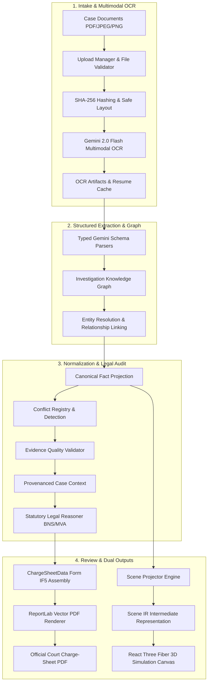

<div align="center">

# ⚖️ BYOMKESH AI (ब्योमकेश)
### Autonomous Provenance-Preserving Crime Investigation, Forensic Scene Reconstruction & Charge-Sheet Generation Engine

[](https://opensource.org/licenses/MIT)
[](https://python.org)
[](https://fastapi.tiangolo.com)
[](https://react.dev)
[](https://threejs.org)
[](https://ai.google.dev)
[](#)

*An end-to-end judicial-grade investigative assistant built for Investigating Officers (IOs), forensic examiners, and legal review teams.*

[Overview](#-overview) •
[System Architecture](#-system-architecture) •
[Core Features](#-core-features) •
[3D Forensic Simulation](#-3d-forensic-simulation-sentinel-hud) •
[Pipeline Stages](#-nine-stage-investigation-pipeline) •
[Quickstart Guide](#-quickstart-guide) •
[API Reference](#-api-reference) •
[Repository Layout](#-repository-layout)

---

</div>

## 📌 Overview

Under the modern Indian criminal justice system (**Bharatiya Nyaya Sanhita 2023 (BNS)**, **Bharatiya Nagarik Suraksha Sanhita 2023 (BNSS)**, and **Bharatiya Sakshya Adhiniyam 2023 (BSA)**), investigating agencies face unprecedented challenges:

- **Massive Documentation Burden:** Investigating Officers manually cross-reference 15+ complex documents per case (FIRs, Spot Panchnamas, Seizure Memos, Medico-Legal Cases (MLCs), Postmortem Autopsies, FSL ballistic/chemical reports, and witness depositions).
- **Provenance Vulnerability:** A single unsourced claim or mismatched timestamp in a Form IF5 Charge-Sheet can lead to evidentiary exclusion or acquittal.
- **Cognitive Scene Reconstruction Gap:** Reconstructing collision angles, braking trajectories, bullet vectors, and conflicting eyewitness testimonies from flat 2D site plans and panchnamas is error-prone.

**BYOMKESH AI** solves this with a **bifurcated hybrid architecture**:
1. **Deterministic & AI-Assisted Document Pipeline:** Ingests heterogeneous physical/digital case dossiers, executes multimodal OCR, parses documents into typed Pydantic models, builds an immutable Knowledge Graph, detects factual conflicts, audits legal elements, and compiles a court-ready **Form IF5 Final Report (Charge-Sheet)** in PDF format.
2. **Interactive 3D Crime Scene Simulation ("Sentinel / Arkham Detective Mode"):** Translates site plans, vehicular mechanical damage, and FSL physical measurements into a high-precision kinematic 3D simulation with dynamic timeline scrubbing, multi-hypothesis toggle, and trajectory visualization.

---

## 🏛 System Architecture



---

## ✨ Core Features

### 1. 🛡️ Unbreakable Chain of Custody & Provenance
Every single claim, person, vehicle, and statutory section in the generated charge-sheet links directly back to its physical origin via `SourceReference` hashes:
- Origin document UUID and SHA-256 checksum
- Exact page number and line bounding coordinates
- Verbatim excerpt citation with confidence score

### 2. 🔍 Statutory Legal Reasoning Engine
- Version-pinned legal dataset covering **Bharatiya Nyaya Sanhita (BNS 2023)** and the **Motor Vehicles Act 1988 (MVA)**.
- Maps evidence items to explicit statutory crime ingredients (e.g. rashness/negligence under BNS 281 vs. mens rea under BNS 103).
- Strict evidence allow-list prevents hallucinations.

### 3. ⚖️ Human-in-the-Loop Review Lifecycle
- Implements four auditable lifecycle states: `DRAFT` ➔ `REVIEW` ➔ `APPROVED` ➔ `FINALIZED`.
- Investigating Officers can apply granular field-level corrections, log judicial notes, and sign off with tamper-evident digital hashes.

### 4. 🧠 Hybrid RAG Subsystem
- In-memory vector similarity retriever backed by Gemini embeddings.
- Context-aware document chunking preserving legal paragraph hierarchies and FIR crime headers.

---

## 🎮 3D Forensic Simulation ("Sentinel" HUD)

The simulation engine (`frontend/src/simulation/`) translates investigation measurements into an interactive 3D WebGL environment inspired by tactical forensic interfaces:

| Feature | Description |
| :--- | :--- |
| **Kinematic Interpolator** | Dynamically calculates velocity curves, braking deceleration, impact points, and post-collision rest positions based on physical evidence (`kinematics.js`). |
| **Conflicting Hypothesis Engine** | Toggle in real-time between conflicting witness statements (e.g., Witness 1 estimating 75 km/h vs. Accused claiming 35 km/h). |
| **Interactive 3D Evidence Markers** | Inspect physical props (crowbars, broken padlocks, blood spatter, skid marks, firearms) directly in 3D coordinate space. |
| **Tactical Camera Controls** | Switch between **Cinematic Director View**, **Tactical 45°**, **Overhead Satellite Grid**, and **Point-of-Impact Focus**. |
| **High-Precision Time Scrubbing** | Interactive 0.0s to 10.0s forensic timeline slider with playback speeds from 0.25x to 2.0x. |

### Built-in Case Benchmark Scenarios:
1. **`case_001_delhi_tpoint`**: Shankar Road T-Point road traffic collision & hit-and-run (BNS 281, BNS 125, MVA 184/134).
2. **`case_002_karol_bagh_burglary`**: Rishi Apartments Flat 302 daytime break-in and ₹18.45 Lakh jewellery burglary (BNS 305, BNS 329, BNS 324).
3. **`case_003_indoor_shooting`**: Enclosed residential ballistics and murder over property dispute (BNS 103(1), BNS 61, BNS 238).

---

## 🔄 Nine-Stage Investigation Pipeline

| Stage | Name | Input ➔ Output | Function |
| :---: | :--- | :--- | :--- |
| **1** | **Intake** | Files ➔ `SourceDocument`, `UploadManifest` | Enforces size limits, validates magic bytes, computes SHA-256 hashes, classifies document types. |
| **2** | **OCR** | `SourceDocument` ➔ `OCRResult` | Multimodal OCR via Gemini 2.0 Flash; provides page-level text, confidence, token usage, and resume caching. |
| **3** | **Parsing** | `OCRResult` ➔ `ParsedDocument` | 13 specialized Pydantic schema parsers (FIR, Panchnama, Seizure Memo, Postmortem, etc.). |
| **4** | **Knowledge Graph** | Parsed Docs ➔ `InvestigationKnowledgeGraph` | Projects documents into an entity-relationship graph with deterministic node IDs and provenance edges. |
| **5** | **Canonicalization** | Graph ➔ `CanonicalInvestigation` | Merges entity identities, builds a unified chronological timeline, and logs conflicting facts into a registry. |
| **6** | **Validation** | Canonical Model ➔ `ValidationReport` | Audits completeness and evidence support; flags disposition (`draft_allowed`, `review_required`, `final_blocked`). |
| **7** | **Case Context** | Investigation ➔ `CaseContext` | Assembles a compact, high-confidence projection containing all evidence needed for prosecution. |
| **8** | **Legal Reasoning** | Context ➔ `LegalFindings` | Evaluates legal ingredients against BNS reference data; records status (`supported`, `insufficient`, `conflicted`). |
| **9** | **Charge Sheet & PDF**| Findings ➔ `ChargeSheetData` ➔ PDF | Formats Form IF5 fields, executes schema validation, and renders a court-ready ReportLab vector PDF. |

---

## 🚀 Quickstart Guide

### Prerequisites
- **Python**: 3.12 or newer
- **Node.js**: 18.0 or newer (npm 9+)
- **Google Gemini API Key**: [Get an API key](https://aistudio.google.com/)

---

### Step 1: Clone and Configure Environment

```bash
git clone https://github.com/NishadShirodkar/Major_Project_2nd_repo.git
cd Major_Project_2nd_repo
```

Create and configure your `backend/.env` file:
```ini
# backend/.env
GEMINI_API_KEY=your_gemini_api_key_here
GOOGLE_API_KEY=your_gemini_api_key_here
LLM_PROVIDER=gemini
GEMINI_MODEL=gemini-2.0-flash
OUTPUT_DIR=output
```

Create and configure your `frontend/.env` file:
```ini
# frontend/.env
VITE_API_BASE_URL=http://127.0.0.1:8000
```

---

### Step 2: Set Up and Run the Backend

```bash
cd backend

# Create and activate a virtual environment
python3.12 -m venv .venv
source .venv/bin/activate

# Install dependencies
pip install -r requirements.txt

# Start the FastAPI service with Uvicorn
PYTHONPATH=. uvicorn src.api.app:app --host 127.0.0.1 --port 8000 --reload
```
*Backend API will be live at `http://127.0.0.1:8000` (Swagger docs: `/docs`).*

---

### Step 3: Set Up and Run the Frontend

In a separate terminal:
```bash
cd frontend

# Install dependencies (includes Three.js, R3F, postprocessing)
npm install

# Start Vite development server
npm run dev
```
*Frontend interface will be live at `http://localhost:5173`.*

---

### Step 4: Running Test Suites

Verify backend stability and pipeline invariants:
```bash
cd backend
PYTHONPATH=. pytest
```

Verify frontend API clients, navigation, and review services:
```bash
cd frontend
npm test
```

---

## 📡 API Reference

The backend exposes a REST API adhering to OpenAPI 3.1 specifications:

### Health & Readiness
| Method | Endpoint | Description |
| :--- | :--- | :--- |
| `GET` | `/health` | Basic service liveness probe. |
| `GET` | `/ready` | Deep readiness check (verifies storage root, BNS dataset, and Gemini configuration). |

### Cases & Uploads
| Method | Endpoint | Description |
| :--- | :--- | :--- |
| `GET` | `/api/v1/cases` | List all investigation cases with status summaries. |
| `POST` | `/api/v1/cases` | Create a new case file. |
| `GET` | `/api/v1/cases/{case_id}` | Retrieve case details, uploaded documents, and current pipeline stage. |
| `POST` | `/api/v1/cases/{case_id}/upload` | Upload case documents (PDF, JPEG, PNG). |
| `POST` | `/api/v1/cases/{case_id}/process` | Trigger the 9-stage pipeline as an asynchronous background job. |

### Jobs & Progress
| Method | Endpoint | Description |
| :--- | :--- | :--- |
| `GET` | `/api/v1/jobs/{job_id}` | Poll background job progress and completed pipeline stages. |

### Artifacts & Review
| Method | Endpoint | Description |
| :--- | :--- | :--- |
| `GET` | `/api/v1/cases/{case_id}/artifacts/{artifact_type}` | Retrieve stage artifacts (`manifest`, `ocr`, `graph`, `validation`, `chargesheet`). |
| `GET` | `/api/v1/cases/{case_id}/artifacts/chargesheet.pdf` | Download the official generated Form IF5 Charge-Sheet PDF. |
| `GET` | `/api/v1/cases/{case_id}/review` | Fetch current charge-sheet data, provenance citations, and review status. |
| `POST` | `/api/v1/cases/{case_id}/review/corrections` | Submit field corrections and auditor observations. |
| `POST` | `/api/v1/cases/{case_id}/review/decision` | Record judicial review decision (`APPROVE` or `FINALIZE`). |

---

## 📂 Repository Layout

```text
Major_Project_2nd_repo/
├── backend/
│   ├── src/
│   │   ├── api/                 # FastAPI service layer (routers, schemas, services)
│   │   │   ├── app.py           # Application factory & middleware
│   │   │   └── routers/         # cases, jobs, artifacts, review, auth, health
│   │   ├── intake/              # File validation, SHA-256 fingerprinting, classification
│   │   ├── extraction/          # Gemini 2.0 Flash Multimodal OCR & resume caching
│   │   ├── parsers/             # Typed Pydantic schema parsers for legal documents
│   │   ├── knowledge_graph/     # Graph models, entity resolver, deterministic builder
│   │   ├── normalization/       # Canonical investigation & conflict detector
│   │   ├── validation/          # Evidence completeness & support auditing
│   │   ├── context/             # Compact provenanced case context builder
│   │   ├── legal/               # BNS statutory reasoner & evidence mapper
│   │   ├── chargesheet/         # Form IF5 data model, populator & validation
│   │   ├── rendering/           # ReportLab vector PDF compiler (if5_renderer.py)
│   │   ├── review/              # Draft ➔ Review ➔ Approved ➔ Finalized lifecycle
│   │   ├── rag/                 # Case retriever, legal chunker, embedding provider
│   │   └── scene/               # 3D Scene Projector & Scene IR generator
│   ├── references/legal/        # Version-pinned BNS 2023 statutory dataset
│   ├── dummy_case/              # Pre-configured test cases (case_001, case_002, case_003)
│   ├── tests/                   # 25+ pytest test suites covering all stages & API
│   └── requirements.txt         # Production & testing Python dependencies
│
├── frontend/
│   ├── public/assets/           # Static 3D GLB models
│   │   ├── vehicles/            # pulsar, activa, sports_bike, vespa
│   │   └── props/               # crowbar, padlock, double_bed, steel_almirah, sofa
│   ├── src/
│   │   ├── simulation/          # 3D WebGL Crime Scene Reconstruction Engine
│   │   │   ├── SceneViewer.jsx  # Main simulation container & clock loop
│   │   │   ├── SceneCanvas.jsx  # R3F Canvas with Bloom, Vignette & Lighting
│   │   │   ├── ArkhamHUD.jsx    # Tactical detective HUD overlay & controls
│   │   │   ├── kinematics.js    # Velocity curves & dynamic trajectory solver
│   │   │   └── scenarios/       # Delhi collision, Karol Bagh burglary, shooting
│   │   ├── pages/               # DashboardPage, InvestigationPage, LoginPage, LandingPage
│   │   ├── components/          # DocumentUploader, ProcessingMonitor, ChargeSheetPreview
│   │   └── services/            # apiClient, caseService, jobService, reviewService
│   ├── tests/                   # Node.js ESM frontend test suite (29 tests)
│   └── package.json             # React 19, Three.js, R3F, Vite configuration
│
├── LICENSE                      # MIT License
└── README.md                    # Project documentation
```

---

## ⚖️ Legal & Ethical Compliance Note

* **Advisory Role:** BYOMKESH AI is strictly an **investigative decision-support system**. It compiles provenance-backed legal drafts, audits evidence completeness, and reconstructs physical topologies. It does **not** replace the statutory discretion or judicial authority of the Investigating Officer, Public Prosecutor, or Judge.
* **Data Sovereignty:** Case documents and extracted entities remain locally isolated within the specified storage root (`OUTPUT_DIR`). No case data is utilized for external model training.

---

## 📄 License

This project is licensed under the [MIT License](LICENSE).